# Pydantic AI docs, rebuilt on an ontology

A prototype that rebuilds the Pydantic AI documentation from typed Python knowledge objects.
It keeps every word of the upstream content, gives the docs an explicit knowledge model,
and generates the navigation from that model instead of maintaining it by hand.

It is an exploration, not a replacement. All content is the upstream Markdown corpus
(MIT licensed, © Pydantic Services Inc.), imported without summarising or rewriting.

## The problem

The current sidebar is the source of truth, so it mixes kinds of page and things drift apart:

- **Core Concepts** holds 16 pages that are a mixture of concepts, guides and features.
- **Models & Providers** is a flat list of 27 entries, and the abstraction (Model) and the
  integrations (OpenAI, Ollama, …) sit at the same level.
- **Capabilities** holds 78 pages, and execution sandboxes sit alongside planning and memory.
- **API Reference** is one 81-page block, far from the concepts each module documents.
- Nothing records *why* pages relate, so "where next?" depends on hand-written links.

## What changed

Every page is placed once in an ontology, which is authored in Python:

- a **domain**, such as Agent definition, Models & providers or Execution & environment
- a **role**: concept, guide, integration, reference, example or project
- **typed relationships**, such as "Agent instantiates Agent Run", "Anthropic is a kind of
  Provider" or "Durable Execution checkpoints Agent Run"

The sidebar is generated from those placements by `ontology_projection()`. Each domain opens
with its core concepts, then its guides and integrations grouped by family, then the API
reference for that domain. Goals ("Build my first agent", "Get reliable answers", …) come first
as entry points. If a placement changes, the navigation changes on the next build.

In each comparison below, the official page is on top and the generated one underneath.

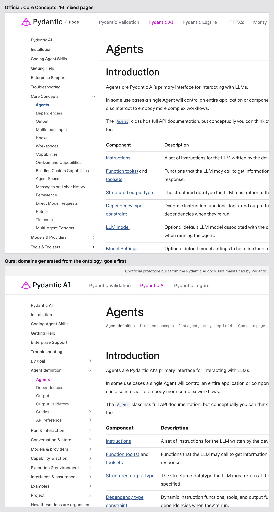

The same page can now sit somewhere more useful. Shell is an execution environment, so it
moves out of Capabilities and is labelled as a kind of Workspace:

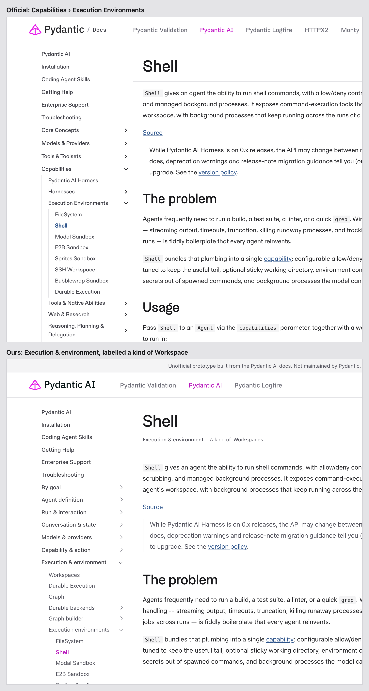

Provider pages become implementations of the Provider concept rather than peers of it:

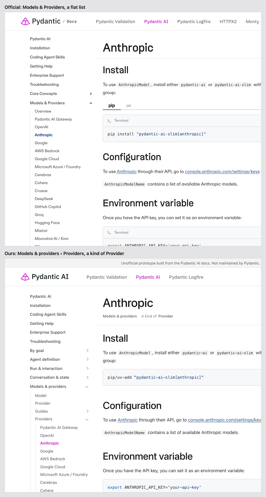

In numbers: 329 pages, with 26 core concepts, 51 guides, 124 integrations, 81 reference pages,
23 examples, 17 project pages and 7 start pages. There are 176 typed relationships, 6 Jobs to be
Done and 6 journeys.

### How a page is placed

```python
_PLACEMENT = {
    "agent.md": (AGENT, Role.CONCEPT, None),
    "models/overview.md": (MODELS, Role.CONCEPT, None),
    "toolsets.md": (ACTION, Role.CONCEPT, None),
    "durable_execution/backends.md": (ENV, Role.GUIDE, "Durable backends"),
    "ui/ag-ui.md": (ASSURE, Role.INTEGRATION, "UI event streams"),
    # … plus rules for whole sections (providers, harness families, API modules)
}
```

Integration families are linked to the concept they implement (`is_a`), and those links feed
the concept map, each page's context and the "alternatives" list.

## Seeing the model

Each page states where it sits, in one quiet line under its title, and ends with an "In the
ontology" section. It lists the page's relationships, the jobs and journeys it belongs to, and
for concepts, the pages that implement it:

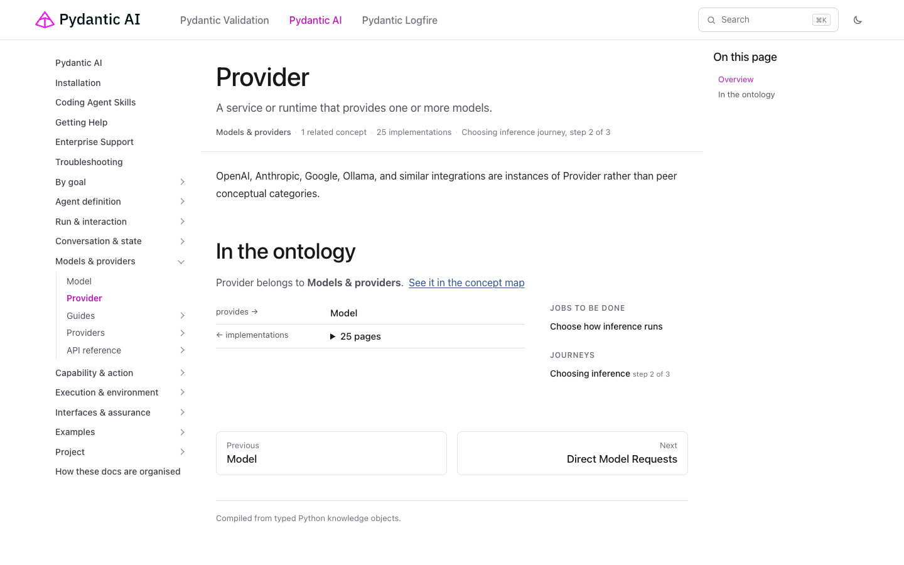

"How these docs are organised" explains the system and shows the live concept map. The map is
generated from the same Python objects as the pages. Domains have fixed positions, the most
connected concept (Agent Run) sits in the centre, and integrations appear as counts
("Provider 25") rather than hundreds of nodes.

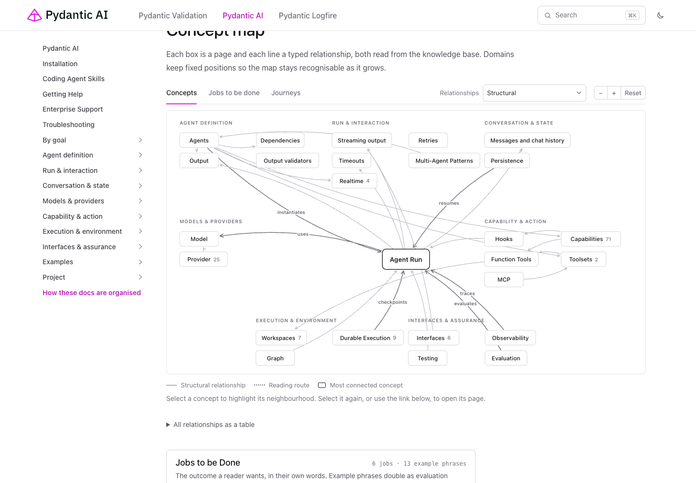

Selecting a concept highlights its neighbourhood:

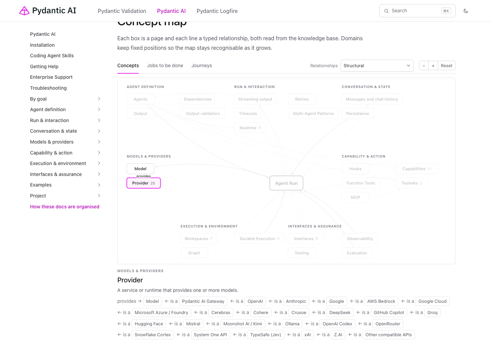

Jobs to be Done and journeys are separate layers on the same map. Selecting "Get reliable
answers" shows the concepts and the journey that realise it:

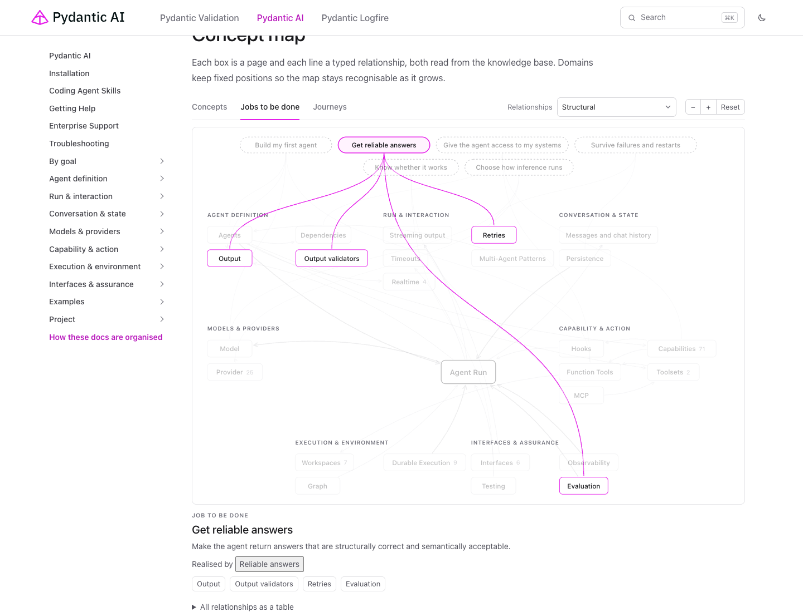

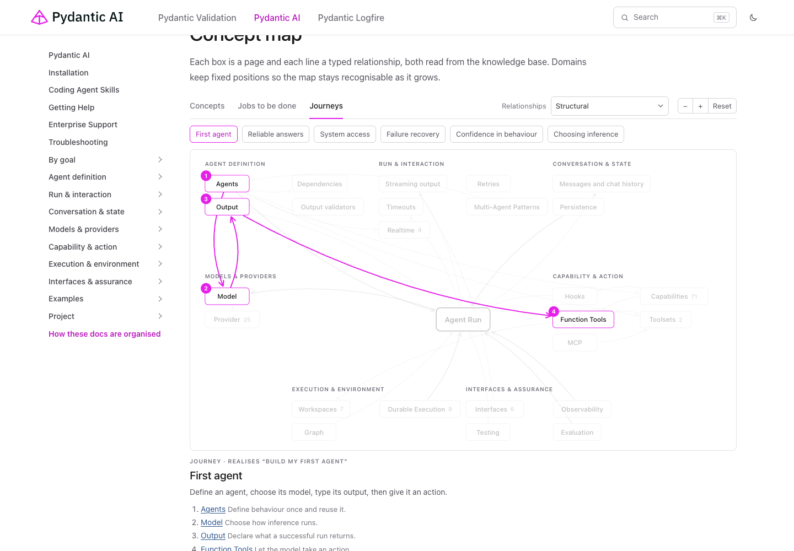

## Reading the docs

The default view is the complete upstream page. Pages with authored, tagged blocks can be
tailored to a reader's intent, experience, style and depth, which selects and orders authored
blocks and generates nothing. The control is one line under the title:

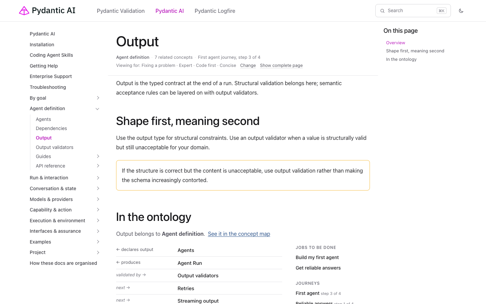

A journey started from the map follows the reader across pages:

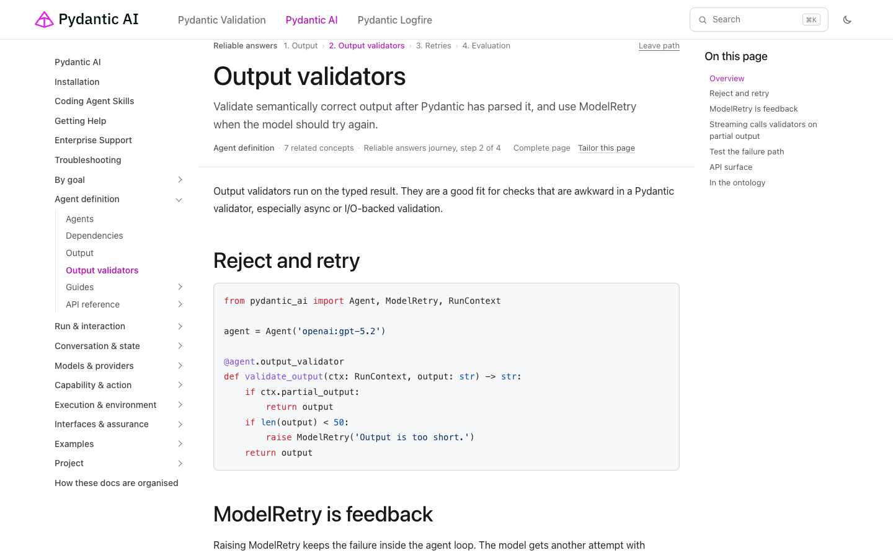

## Where AI is and isn't used

AI does not write any documentation. Search is ordinary search, known relationships are
deterministic, and page composition is deterministic.

The one optional AI component is a small routing model that runs in the browser and picks
between authored pages for a free-text goal. Its evaluation cases are generated from the Jobs
to be Done phrases, and it ships only if it beats deterministic baselines. Today the gate
reports `AI_NOT_YET_JUSTIFIED`: the baselines reach 7.7% route@1 and 23.1% hit@3 on 13 cases,
and no model experiment has been supplied yet.

## It still looks like the Pydantic docs

The shell follows the unified docs at pydantic.dev/docs. The header, column widths, zinc
neutrals, type scale and code frames were measured from the live site, as were the callout
palette, annotations, copy buttons and search dialog. Each pair below shows the official page above
and ours below, at the same viewport and scroll position:

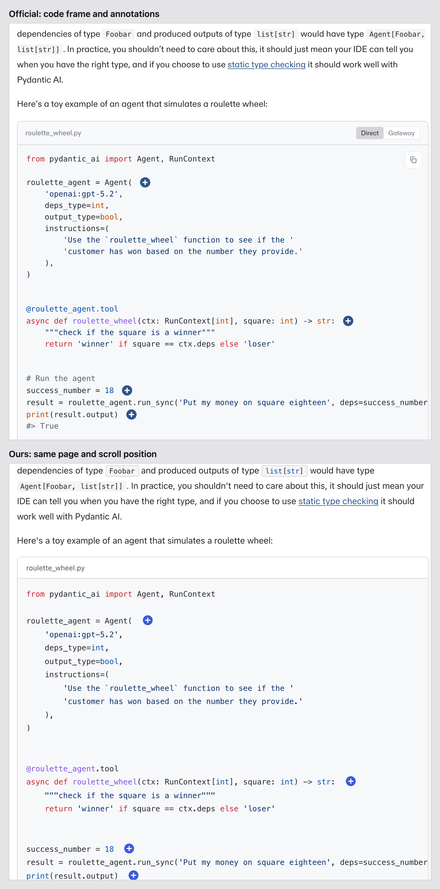

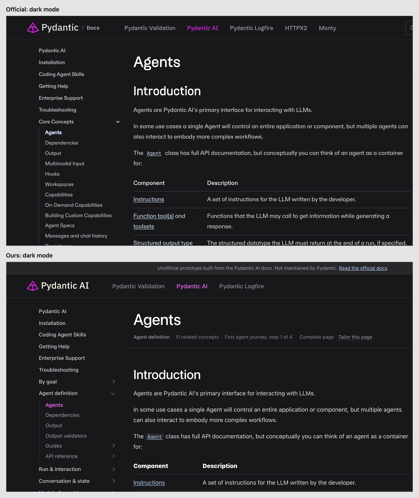

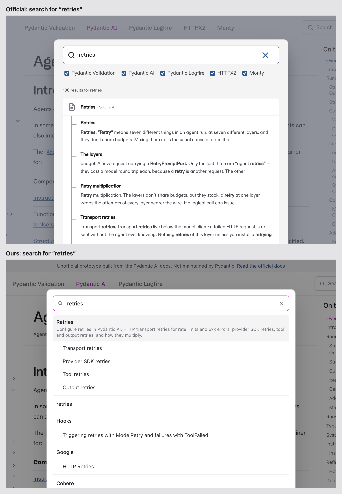

It also works on mobile and in dark mode:

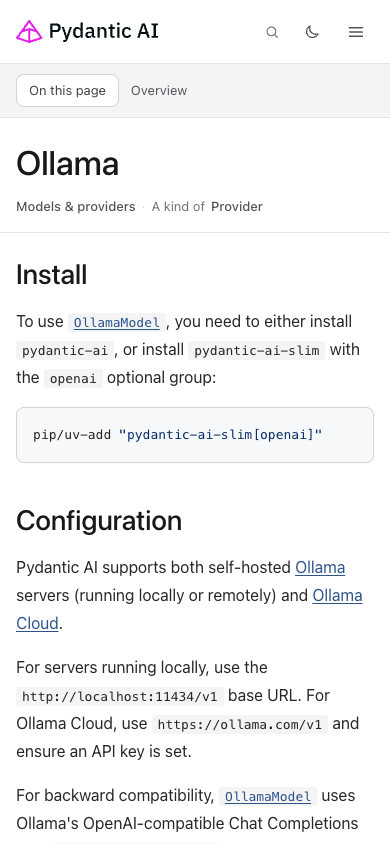

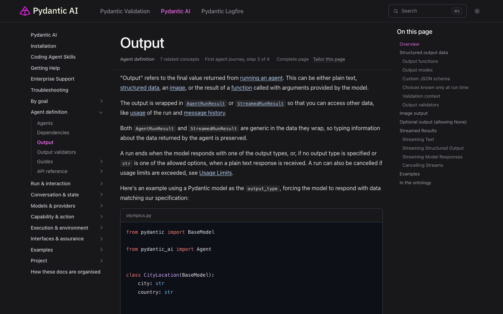

Every page is complete HTML that works without JavaScript. JavaScript only adds search,
tailoring, journeys and the map's interaction. Three build targets share one design:

- a static site
- an offline copy where every page stands alone
- a single HTML file

## Try it

```bash
uv sync --extra dev --extra evals
uv run pydantic-knowledge build examples/pydantic_ai_docs.py --out site
python -m http.server --directory site     # then open http://localhost:8000
```

Or read the hosted build, if the repository has GitHub Pages enabled (see the README).
Every page there is marked as an unofficial prototype and links to the official docs.

Other targets and checks:

```bash
uv run pydantic-knowledge build examples/pydantic_ai_docs.py --target offline --out outputs/offline
uv run pydantic-knowledge build examples/pydantic_ai_docs.py --target single --out outputs/pydantic-ai-single.html
uv run pydantic-knowledge eval examples/pydantic_ai_docs.py --out outputs/evals
uv run pytest
```

## Open questions and known gaps

- **Placements are editorial.** Realtime under Run & interaction, Observability under Interfaces
  & assurance, and sandboxes under Execution & environment are judgement calls; each is one
  line to change.
- **URLs.** The 13 imported pages that became core concepts have new, shorter IDs, such as
  `toolset.html`. A real migration would need redirects.
- **Fonts.** ABC Diatype and Dwight are not bundled, so the prototype falls back to system fonts.
- **Search** matches page and section titles only. Upstream also indexes body text.
- **Offline size.** The offline build inlines the sidebar and search index into every page,
  about 140 MB in total.
- **Upstream order** is kept as a second projection in the data but is not yet switchable in
  the UI.
