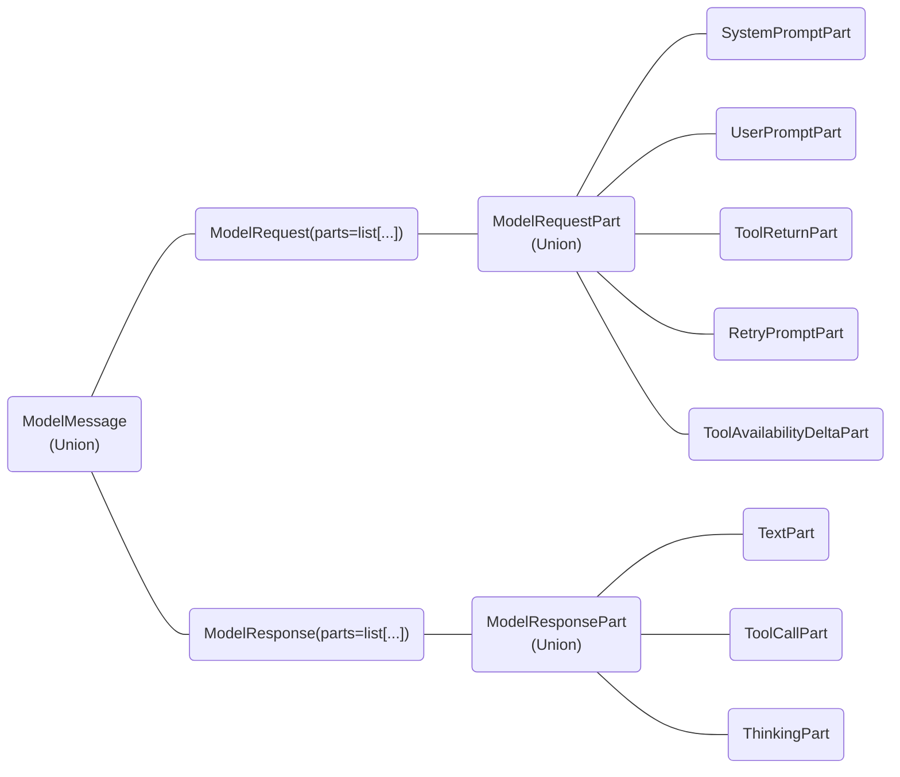

# `pydantic_ai.messages`

The structure of [`ModelMessage`][pydantic_ai.messages.ModelMessage] can be shown as a graph:



### `SystemPromptPart`

```python
class SystemPromptPart
```


A system prompt, generally written by the application developer.

This gives the model context and guidance on how to respond.

```python
content: str
```

```python
_: KW_ONLY
```

```python
timestamp: datetime = field(default_factory=_now_utc)
```

```python
dynamic_ref: str | None = None
```

```python
part_kind: Literal['system-prompt'] = 'system-prompt'
```


### `FileUrl`

```python
class FileUrl
```


Abstract base class for any URL-based file.

```python
url: str
```

```python
_: KW_ONLY
```

```python
force_download: ForceDownloadMode = False
```

```python
vendor_metadata: dict[str, Any] | None = None
```

```python
_media_type: Annotated[str | None, pydantic.Field(alias='media_type', default=None, exclude=True)] = field(compare=False, default=None)
```

```python
_identifier: Annotated[str | None, pydantic.Field(alias='identifier', default=None, exclude=True)] = field(compare=False, default=None)
```

#### `media_type`

```python
def media_type(self) -> str
```


Return the media type of the file, based on the URL or the provided `media_type`.

#### `identifier`

```python
def identifier(self) -> str
```


The identifier of the file, such as a unique ID.

This identifier can be provided to the model in a message to allow it to refer to this file in a tool call argument,
and the tool can look up the file in question by iterating over the message history and finding the matching `FileUrl`.

This identifier is only automatically passed to the model when the `FileUrl` is returned by a tool.
If you're passing the `FileUrl` as a user message, it's up to you to include a separate text part with the identifier,
e.g. "This is file <identifier>:" preceding the `FileUrl`.

It's also included in inline-text delimiters for providers that require inlining text documents, so the model can
distinguish multiple files.


#### `format`

```python
def format(self) -> str
```


The file format.

### `VideoUrl`

```python
class VideoUrl
```


A URL to a video.

```python
url: str
```

```python
_: KW_ONLY
```

```python
kind: Literal['video-url'] = 'video-url'
```


#### `is_youtube`

```python
def is_youtube(self) -> bool
```


True if the URL is on a YouTube host that models can resolve directly.

This is a specific set of hosts rather than every YouTube-owned domain, so
`music.youtube.com` is deliberately not one of them.

#### `format`

```python
def format(self) -> VideoFormat
```


The file format of the video.

The choice of supported formats were based on the Bedrock Converse API. Other APIs don't require to use a format.

### `AudioUrl`

```python
class AudioUrl
```


A URL to an audio file.

```python
url: str
```

```python
_: KW_ONLY
```

```python
kind: Literal['audio-url'] = 'audio-url'
```


#### `format`

```python
def format(self) -> AudioFormat
```


The file format of the audio file.

### `ImageUrl`

```python
class ImageUrl
```


A URL to an image.

```python
url: str
```

```python
_: KW_ONLY
```

```python
kind: Literal['image-url'] = 'image-url'
```


#### `format`

```python
def format(self) -> ImageFormat
```


The file format of the image.

The choice of supported formats were based on the Bedrock Converse API. Other APIs don't require to use a format.

### `DocumentUrl`

```python
class DocumentUrl
```


The URL of the document.

```python
url: str
```

```python
_: KW_ONLY
```

```python
kind: Literal['document-url'] = 'document-url'
```


#### `format`

```python
def format(self) -> DocumentFormat
```


The file format of the document.

The choice of supported formats were based on the Bedrock Converse API. Other APIs don't require to use a format.

### `TextContent`

```python
class TextContent
```


String content that is tagged with additional metadata.

This is useful for including metadata that can be accessed programmatically by the application, but is not sent to the LLM.

```python
content: str
```

```python
_: KW_ONLY
```

```python
metadata: Any = None
```

```python
kind: Literal['text-content'] = 'text-content'
```

### `BinaryContent`

```python
class BinaryContent
```


Binary content, e.g. an audio or image file.

```python
data: bytes
```

```python
_: KW_ONLY
```

```python
media_type: AudioMediaType | ImageMediaType | DocumentMediaType | str
```

```python
vendor_metadata: dict[str, Any] | None = None
```

```python
_identifier: Annotated[str | None, pydantic.Field(alias='identifier', default=None, exclude=True)] = field(compare=False, default=None)
```

```python
kind: Literal['binary'] = 'binary'
```

#### `narrow_type`

```python
def narrow_type(bc: BinaryContent) -> BinaryContent | BinaryImage
```


Narrow the type of the `BinaryContent` to `BinaryImage` if it's an image.

#### `from_data_uri`

```python
def from_data_uri(cls, data_uri: str) -> BinaryContent
```


Create a `BinaryContent` from a data URI.

#### `from_path`

```python
def from_path(cls, path: PathLike[str]) -> BinaryContent
```


Create a `BinaryContent` from a path.

Defaults to 'application/octet-stream' if the media type cannot be inferred.

Raises:
    FileNotFoundError: if the file does not exist.
    PermissionError: if the file cannot be read.

#### `identifier`

```python
def identifier(self) -> str
```


Identifier for the binary content, such as a unique ID.

This identifier can be provided to the model in a message to allow it to refer to this file in a tool call argument,
and the tool can look up the file in question by iterating over the message history and finding the matching `BinaryContent`.

This identifier is only automatically passed to the model when the `BinaryContent` is returned by a tool.
If you're passing the `BinaryContent` as a user message, it's up to you to include a separate text part with the identifier,
e.g. "This is file <identifier>:" preceding the `BinaryContent`.

It's also included in inline-text delimiters for providers that require inlining text documents, so the model can
distinguish multiple files.

#### `data_uri`

```python
def data_uri(self) -> str
```


Convert the `BinaryContent` to a data URI.

#### `base64`

```python
def base64(self) -> str
```


Return the binary data as a base64-encoded string. Default encoding is UTF-8.

#### `is_audio`

```python
def is_audio(self) -> bool
```


Return `True` if the media type is an audio type.

#### `is_image`

```python
def is_image(self) -> bool
```


Return `True` if the media type is an image type.

#### `is_video`

```python
def is_video(self) -> bool
```


Return `True` if the media type is a video type.

#### `is_document`

```python
def is_document(self) -> bool
```


Return `True` if the media type is a document type.

#### `format`

```python
def format(self) -> str
```


The file format of the binary content.

### `BinaryImage`

```python
class BinaryImage
```


Binary content that's guaranteed to be an image.

### `BinaryAudio`

```python
class BinaryAudio
```


Binary content that's guaranteed to be audio.

### `CachePoint`

```python
class CachePoint
```


A cache point marker for prompt caching.

Can be inserted into UserPromptPart.content to mark cache boundaries.
Models that don't support caching will filter these out.

Supported by:

- Anthropic
- Amazon Bedrock (Converse API)
- OpenAI (GPT-5.6 models)
- OpenRouter (Anthropic and Gemini models via `OpenRouterModel`, plus OpenAI GPT-5.6 models when
  using `OpenAIChatModel` or `OpenAIResponsesModel` with `OpenRouterProvider`)

```python
kind: Literal['cache-point'] = 'cache-point'
```

```python
ttl: Literal['5m', '1h'] = '5m'
```

### `UploadedFile`

```python
class UploadedFile
```


A reference to a file uploaded to a provider's file storage by ID.

This allows referencing files that have been uploaded via provider-specific file APIs
rather than providing the file content directly.

Supported by:

- [`AnthropicModel`][pydantic_ai.models.anthropic.AnthropicModel]
- [`OpenAIChatModel`][pydantic_ai.models.openai.OpenAIChatModel]
- [`OpenAIResponsesModel`][pydantic_ai.models.openai.OpenAIResponsesModel]
- [`BedrockConverseModel`][pydantic_ai.models.bedrock.BedrockConverseModel]
- [`GoogleModel`][pydantic_ai.models.google.GoogleModel] (Gemini API: [Files API](https://ai.google.dev/gemini-api/docs/files) URIs, Google Cloud: GCS `gs://` URIs)
- [`XaiModel`][pydantic_ai.models.xai.XaiModel]

```python
file_id: str
```

```python
provider_name: UploadedFileProviderName
```

```python
_: KW_ONLY
```

```python
vendor_metadata: dict[str, Any] | None = None
```

```python
_media_type: Annotated[str | None, pydantic.Field(alias='media_type', default=None, exclude=True)] = field(compare=False, default=None)
```

```python
_identifier: Annotated[str | None, pydantic.Field(alias='identifier', default=None, exclude=True)] = field(compare=False, default=None)
```

```python
kind: Literal['uploaded-file'] = 'uploaded-file'
```

#### `media_type`

```python
def media_type(self) -> str
```


Return the media type of the file, inferred from `file_id` if not explicitly provided.

Note: Inference relies on the file extension in `file_id`.
For opaque file IDs (e.g., `'file-abc123'`), the media type will default to `'application/octet-stream'`.
Inference relies on Python's `mimetypes` module, whose results may vary across platforms.

Required by some providers (e.g., Bedrock) for certain file types.

#### `identifier`

```python
def identifier(self) -> str
```


The identifier of the file, such as a unique ID.

This identifier can be provided to the model in a message to allow it to refer to this file in a tool call argument,
and the tool can look up the file in question by iterating over the message history and finding the matching `UploadedFile`.

This identifier is only automatically passed to the model when the `UploadedFile` is returned by a tool.
If you're passing the `UploadedFile` as a user message, it's up to you to include a separate text part with the identifier,
e.g. "This is file <identifier>:" preceding the `UploadedFile`.

#### `format`

```python
def format(self) -> str
```


A general-purpose media-type-to-format mapping.

Maps media types to format strings (e.g. `'image/png'` -> `'png'`). Covers image, video,
audio, and document types. Currently used by Bedrock, which requires explicit format strings.

### `is_multi_modal_content`

```python
def is_multi_modal_content(obj: Any) -> TypeGuard[MultiModalContent]
```


Check if obj is a MultiModalContent type, enabling type narrowing.

### `ToolReturn`

```python
class ToolReturn
```


A structured tool return that separates the tool result from additional content sent to the model.

Can be parameterized with a type to enable return schema generation:
- `ToolReturn[User]` — generates a return schema for `User`
- `ToolReturn` (bare) — no return schema generated

```python
return_value: ToolReturnContent
```

```python
_: KW_ONLY
```

```python
content: str | Sequence[UserContent] | None = None
```

```python
metadata: Any = None
```

```python
tools: list[str] | None = None
```

```python
kind: Literal['tool-return'] = 'tool-return'
```


### `UserPromptPart`

```python
class UserPromptPart
```


A user prompt, generally written by the end user.

Content comes from the `user_prompt` parameter of [`Agent.run`][pydantic_ai.agent.AbstractAgent.run],
[`Agent.run_sync`][pydantic_ai.agent.AbstractAgent.run_sync], and [`Agent.run_stream`][pydantic_ai.agent.AbstractAgent.run_stream].

```python
content: str | Sequence[UserContent]
```

```python
_: KW_ONLY
```

```python
timestamp: datetime = field(default_factory=_now_utc)
```

```python
part_kind: Literal['user-prompt'] = 'user-prompt'
```


### `parse_tool_kind`

```python
def parse_tool_kind(value: str) -> ToolPartKind | None
```


Return `value` if it's a known [`ToolPartKind`][pydantic_ai.messages.ToolPartKind], else `None`.

UI adapters call this at the wire boundary to validate an untrusted client-supplied `tool_kind`
string before setting it on a part, so an unknown value degrades to `None` rather than asserting a
bogus discriminator.


### `BaseToolReturnPart`

```python
class BaseToolReturnPart
```


Base class for tool return parts.

```python
tool_name: str
```

```python
content: ToolReturnContent
```

```python
tool_call_id: str = field(default_factory=_generate_tool_call_id)
```

```python
_: KW_ONLY
```

```python
tool_kind: ToolPartKind | None = None
```

```python
metadata: Any = None
```

```python
timestamp: datetime = field(default_factory=_now_utc)
```

```python
outcome: Literal['success', 'failed', 'denied', 'interrupted'] = 'success'
```


#### `files`

```python
def files(self) -> list[MultiModalContent]
```


The multimodal file parts from `content` (`ImageUrl`, `AudioUrl`, `DocumentUrl`, `VideoUrl`, `BinaryContent`).

#### `content_items`

```python
def content_items(self, *, mode: Literal['raw', 'str', 'jsonable']='raw', wrap_if_error: bool=True) -> list[ToolReturnContent] | list[str | MultiModalContent] | list[Any | MultiModalContent]
```


Return content as a flat list for iteration, with optional serialization.

Args:
    mode: Controls serialization of non-file items:
        - `'raw'`: No serialization. Returns items as-is.
        - `'str'`: Non-file items are serialized to strings via `tool_return_ta`.
          File items (`MultiModalContent`) pass through unchanged.
        - `'jsonable'`: Non-file items are serialized to JSON-compatible Python objects
          via `tool_return_ta`. File items pass through unchanged.
    wrap_if_error: Whether to wrap failed tool returns in an `{"error": ...}` object (ignored in
        `'raw'` mode). When `True` (the default), a failed return's non-file data collapses into a
        single wrapped error item so providers without a native error channel still see the failure
        explicitly; files pass through unchanged. Set this to `False` when the provider has a native
        error channel (e.g. Anthropic `is_error`) and should receive the content unwrapped.

#### `model_response_str`

```python
def model_response_str(self, *, wrap_if_error: bool=True) -> str
```


Return a string representation of the data content for the model.

This excludes multimodal files - use `.files` to get those separately.

Args:
    wrap_if_error: Whether to wrap failed tool returns in an `{"error": ...}` object.
        Set this to `False` when the provider has a native error channel.

#### `model_response_object`

```python
def model_response_object(self, *, wrap_if_error: bool=True) -> dict[str, Any]
```


Return a dictionary representation of the data content, wrapping non-dict types appropriately.

This excludes multimodal files - use `.files` to get those separately.
Gemini supports JSON dict return values, but no other JSON types, hence we wrap anything else in a dict.

Args:
    wrap_if_error: Whether to wrap failed tool returns in an `{"error": ...}` object.
        Set this to `False` when the provider has a native error channel.

#### `structured_content`

```python
def structured_content(self) -> dict[str, Any] | list[Any] | None
```


Return `content` as structured JSON data (a `dict` or `list`), or `None` if it has none.

A JSON string is parsed; already-structured content is returned as-is; a plain/non-JSON
string, scalar, or multimodal content yields `None` (there is no structured payload). A
read-side companion to [`files`][pydantic_ai.messages.BaseToolReturnPart.files] and
[`model_response_object`][pydantic_ai.messages.BaseToolReturnPart.model_response_object]; some
UI wire formats (e.g. AG-UI) transmit tool results as JSON strings, so
[`narrow_type`][pydantic_ai.messages.ToolReturnPart.narrow_type] uses it to recover the
structured payload a typed return subclass expects.

#### `model_response_str_and_user_content`

```python
def model_response_str_and_user_content(self, *, wrap_if_error: bool=True) -> tuple[str, list[UserContent]]
```


Build a text-only tool result with multimodal files extracted for a trailing user message.

For providers whose tool result API only accepts text. Multimodal files are referenced
by identifier in the tool result text ('See file {id}.') and included in full in the
returned file content list.

Each file is framed by `_tool_result_provenance_tags` so the model can tell it from the
user's own uploads, which travel on the same channel.

Args:
    wrap_if_error: Whether to wrap failed tool returns in an `{"error": ...}` object.
        Set this to `False` when the provider has a native error channel.

#### `has_content`

```python
def has_content(self) -> bool
```


Return `True` if the tool return has content.

### `ToolReturnPart`

```python
class ToolReturnPart
```


A tool return message, this encodes the result of running a tool.

```python
_: KW_ONLY
```

```python
part_kind: Literal['tool-return'] = 'tool-return'
```

#### `narrow_type`

```python
def narrow_type(part: ToolReturnPart, *, tool_kind: ToolPartKind | None=None) -> ToolReturnPart
```


Promote a base `ToolReturnPart` to its typed subclass when its `tool_kind` is registered.

Best-effort: returns the part unchanged when the `tool_kind` (kwarg or on the part) resolves to
no registered subclass, and strips an unsubstantiated `tool_kind` when the part's data doesn't
validate against that subclass — keeping it on a base part would break a
[`ModelMessagesTypeAdapter`][pydantic_ai.messages.ModelMessagesTypeAdapter] round-trip. For
direct construction; Pydantic deserialization promotes automatically via the discriminated union.

### `NativeToolReturnPart`

```python
class NativeToolReturnPart
```


A tool return message from a native tool.

For native tools with a stable cross-provider shape (currently `tool_search`), a
`NativeToolReturnPart` may be promoted to a typed subclass like
[`NativeToolSearchReturnPart`][pydantic_ai.messages.NativeToolSearchReturnPart]
with a narrowed `content` `TypedDict`. See `NativeToolCallPart` for the pattern.

```python
_: KW_ONLY
```

```python
provider_name: str | None = None
```

```python
provider_details: dict[str, Any] | None = None
```

```python
part_kind: Literal['builtin-tool-return'] = 'builtin-tool-return'
```

#### `narrow_type`

```python
def narrow_type(part: NativeToolReturnPart, *, tool_kind: ToolPartKind | None=None) -> NativeToolReturnPart
```


Promote a base `NativeToolReturnPart` to its typed subclass when its `tool_kind` is registered.

Best-effort: returns the part unchanged when the `tool_kind` (kwarg or on the part) resolves to
no registered subclass, and strips an unsubstantiated `tool_kind` when the part's data doesn't
validate against that subclass — keeping it on a base part would break a
[`ModelMessagesTypeAdapter`][pydantic_ai.messages.ModelMessagesTypeAdapter] round-trip. For
direct construction; Pydantic deserialization promotes automatically via the discriminated union.

### `RetryPromptPart`

```python
class RetryPromptPart
```


A message back to a model asking it to try again.

This can be sent for a number of reasons:

* Pydantic validation of tool arguments failed, here content is derived from a Pydantic
  [`ValidationError`][pydantic_core.ValidationError]
* a tool raised a [`ModelRetry`][pydantic_ai.exceptions.ModelRetry] exception
* no tool was found for the tool name
* the model returned plain text when a structured response was expected
* Pydantic validation of a structured response failed, here content is derived from a Pydantic
  [`ValidationError`][pydantic_core.ValidationError]
* an output validator raised a [`ModelRetry`][pydantic_ai.exceptions.ModelRetry] exception

```python
content: list[pydantic_core.ErrorDetails] | str
```

```python
_: KW_ONLY
```

```python
tool_name: str | None = None
```

```python
tool_call_id: str = field(default_factory=_generate_tool_call_id)
```

```python
timestamp: datetime = field(default_factory=_now_utc)
```

```python
part_kind: Literal['retry-prompt'] = 'retry-prompt'
```

#### `from_error`

```python
def from_error(cls, error: pydantic_core.ValidationError | ModelRetry, *, tool_name: str | None=None, tool_call_id: str | None=None) -> RetryPromptPart
```


Build the retry prompt for a failed tool call or output validation.

This is the exact message the model receives when the error is handled by the agent loop,
so anything else presenting the failure (e.g. instrumentation spans) must build it the same way.

#### `model_response`

```python
def model_response(self) -> str
```


Return a string message describing why the retry is requested.

### `AgentInstructionSource`

```python
class AgentInstructionSource
```


The agent's own instructions.

There is exactly one agent in scope, so it carries no id.

### `ToolsetInstructionSource`

```python
class ToolsetInstructionSource
```


A toolset with an `id`.

```python
id: str
```

### `CapabilityInstructionSource`

```python
class CapabilityInstructionSource
```


A capability with an `id`.

```python
id: str
```

### `InstructionId`

```python
class InstructionId
```


The key an instruction part is addressed by: who contributed it, and which of their parts it is.

```python
source: InstructionSource
```

```python
_: KW_ONLY
```

```python
name: str | None = None
```


### `InstructionPart`

```python
class InstructionPart
```


A single instruction part with metadata about its origin.

Instructions are composed of one or more parts, each of which can be static (from a literal string)
or dynamic (from a function, template, or toolset). This distinction allows model implementations
to make intelligent caching decisions — e.g. Anthropic's prompt caching can cache the static prefix
while leaving dynamic instructions uncached.

```python
content: str
```

```python
_: KW_ONLY
```

```python
dynamic: bool = False
```

```python
name: str | None = None
```

```python
id: SerializedInstructionId = None
```

```python
part_kind: Literal['instruction'] = 'instruction'
```

#### `join`

```python
def join(parts: Sequence[InstructionPart]) -> str | None
```


Join instruction parts into a single string, separated by double newlines.

#### `sorted`

```python
def sorted(parts: Sequence[InstructionPart]) -> list[InstructionPart]
```


Sort instruction parts with static (`dynamic=False`) before dynamic, preserving relative order.

### `ToolAvailabilityDeltaPart`

```python
class ToolAvailabilityDeltaPart
```


Records that the set of tools available to the model changed at this point.

Additions only. Withdrawing a tool is not supported yet, because no provider can be told about one
without also invalidating the prompt cache this part exists to protect: Anthropic rejects a
reference to a tool the request doesn't declare, so a withdrawn tool has to leave the `tools`
array, and that is itself the invalidation. The name says *availability* rather than *addition* so
removals can join once they can be done cache-safely — see
https://github.com/pydantic/pydantic-ai/issues/6985.

```python
tools_added: Annotated[list[str], pydantic.Field(validation_alias=pydantic.AliasChoices('tools_added', 'added'))] = field(default_factory=lambda: [])
```

```python
tool_call_id: str | None = None
```

```python
part_kind: Literal['tool-availability-delta'] = 'tool-availability-delta'
```

#### `otel_message_parts`

```python
def otel_message_parts(self, settings: InstrumentationSettings) -> list[_otel_messages.MessagePart]
```


Render the change as trace content.

Tool names are recorded regardless of `include_content`: they aren't user content, they're
already visible in the request's tool definitions, and a run where the model suddenly can
call something is unreadable without them.

### `ModelRequest`

```python
class ModelRequest
```


A request generated by Pydantic AI and sent to a model, e.g. a message from the Pydantic AI app to the model.

```python
parts: Sequence[ModelRequestPart]
```

```python
_: KW_ONLY
```

```python
timestamp: datetime | None = None
```

```python
instructions: str | None = None
```

```python
kind: Literal['request'] = 'request'
```

```python
run_id: str | None = None
```

```python
conversation_id: str | None = None
```

```python
metadata: dict[str, Any] | None = None
```

```python
state: ModelRequestState = 'complete'
```

#### `user_text_prompt`

```python
def user_text_prompt(cls, user_prompt: str, *, instructions: str | None=None) -> ModelRequest
```


Create a `ModelRequest` with a single user prompt as text.

### `TextPart`

```python
class TextPart
```


A plain text response from a model.

```python
content: str
```

```python
_: KW_ONLY
```

```python
id: str | None = None
```

```python
provider_name: str | None = None
```

```python
provider_details: dict[str, Any] | None = None
```

```python
part_kind: Literal['text'] = 'text'
```

#### `has_content`

```python
def has_content(self) -> bool
```


Return `True` if the text content is non-empty.

### `ThinkingPart`

```python
class ThinkingPart
```


A thinking response from a model.

```python
content: str
```

```python
_: KW_ONLY
```

```python
id: str | None = None
```

```python
signature: str | None = None
```

```python
provider_name: str | None = None
```

```python
provider_details: dict[str, Any] | None = None
```

```python
part_kind: Literal['thinking'] = 'thinking'
```

#### `has_content`

```python
def has_content(self) -> bool
```


Return `True` if the thinking content is non-empty.

### `CompactionPart`

```python
class CompactionPart
```


A compaction part that summarizes previous conversation history.

Compaction parts contain an opaque or readable summary of prior messages,
produced by provider-specific compaction mechanisms. They must be round-tripped
back to the same provider in subsequent requests.

For Anthropic, `content` contains a readable text summary.
For OpenAI, `content` is `None` and the encrypted data is stored in `provider_details`.

```python
content: str | None = None
```

```python
_: KW_ONLY
```

```python
id: str | None = None
```

```python
provider_name: str | None = None
```

```python
provider_details: dict[str, Any] | None = None
```

```python
part_kind: Literal['compaction'] = 'compaction'
```

#### `has_content`

```python
def has_content(self) -> bool
```


Return `True` if the compaction content is non-empty.

### `FilePart`

```python
class FilePart
```


A file response from a model.

```python
content: Annotated[BinaryContent, pydantic.AfterValidator(BinaryContent.narrow_type)]
```

```python
_: KW_ONLY
```

```python
id: str | None = None
```

```python
provider_name: str | None = None
```

```python
provider_details: dict[str, Any] | None = None
```

```python
part_kind: Literal['file'] = 'file'
```

#### `has_content`

```python
def has_content(self) -> bool
```


Return `True` if the file content is non-empty.

### `SpeechPart`

```python
class SpeechPart
```


Spoken audio exchanged during a realtime session, paired with its transcript.

This part is a member of both [`ModelRequestPart`][pydantic_ai.messages.ModelRequestPart] and
[`ModelResponsePart`][pydantic_ai.messages.ModelResponsePart], distinguished by `speaker`:
in `ModelRequest.parts` the speaker is always `'user'`; in `ModelResponse.parts` it is always
`'assistant'`. This invariant is enforced at runtime when a message is constructed.

Standard (non-realtime) models can't consume this part directly; when history containing it is
used in an agent run, [`Model.prepare_messages`][pydantic_ai.models.Model.prepare_messages]
converts user-speaker parts to [`UserPromptPart`][pydantic_ai.messages.UserPromptPart]s and
assistant-speaker parts to [`TextPart`][pydantic_ai.messages.TextPart]s.

```python
speaker: Literal['user', 'assistant']
```

```python
transcript: str | None = None
```

```python
audio: BinaryContent | None = None
```

```python
interrupted_at_ms: int | None = None
```

```python
id: str | None = None
```

```python
provider_name: str | None = None
```

```python
provider_details: dict[str, Any] | None = None
```

```python
part_kind: Literal['speech'] = 'speech'
```

#### `content`

```python
def content(self) -> str
```


The transcript, or an empty string if transcription was unavailable.

Mirrors [`TextPart.content`][pydantic_ai.messages.TextPart.content] so code that renders
message parts generically can treat spoken content like text.

#### `has_content`

```python
def has_content(self) -> bool
```


Return `True` if the part has a transcript or retained audio.

### `BaseToolCallPart`

```python
class BaseToolCallPart
```


A tool call from a model.

```python
tool_name: str
```

```python
args: str | dict[str, Any] | None = None
```

```python
tool_call_id: str = field(default_factory=_generate_tool_call_id)
```

```python
_: KW_ONLY
```

```python
tool_kind: ToolPartKind | None = None
```

```python
id: str | None = None
```

```python
provider_name: str | None = None
```

```python
provider_details: dict[str, Any] | None = None
```

#### `args_as_dict`

```python
def args_as_dict(self, *, raise_if_invalid: bool=False) -> dict[str, Any]
```


Return the arguments as a Python dictionary.

This is just for convenience with models that require dicts as input.

Args:
    raise_if_invalid: If `True`, a `ValueError` or `AssertionError`
        caused by malformed or non-object JSON in `args` will be re-raised.  When
        `False` (the default), such JSON is handled gracefully by
        returning `{'INVALID_JSON': '<raw args>'}` so that the value
        can still be sent to a model API (e.g. during a retry flow)
        without crashing.

#### `args_as_json_str`

```python
def args_as_json_str(self) -> str
```


Return the arguments as a JSON string.

This is just for convenience with models that require JSON strings as input.

JSON that's malformed or doesn't represent an object is handled gracefully by returning
`'{"INVALID_JSON":"<raw args>"}'`, matching [`args_as_dict`][pydantic_ai.messages.BaseToolCallPart.args_as_dict],
so that the value can still be sent to a model API (e.g. during a retry flow) instead of being rejected
by one that requires an object.

Because of that, this is not the way to render args that are still streaming in: a partial fragment
that only becomes valid JSON once the following deltas are concatenated would be degraded to the
wrapper. Emit those verbatim instead, as the UI event streams do.

#### `has_content`

```python
def has_content(self) -> bool
```


Return `True` if the tool call has content.

### `ToolCallPart`

```python
class ToolCallPart
```


A tool call from a model.

```python
_: KW_ONLY
```

```python
part_kind: Literal['tool-call'] = 'tool-call'
```

#### `narrow_type`

```python
def narrow_type(part: ToolCallPart, *, tool_kind: ToolPartKind | None=None) -> ToolCallPart
```


Promote a base `ToolCallPart` to its typed subclass when its `tool_kind` is registered.

Best-effort: returns the part unchanged when the `tool_kind` (kwarg or on the part) resolves to
no registered subclass, and strips an unsubstantiated `tool_kind` when the part's data doesn't
validate against that subclass — keeping it on a base part would break a
[`ModelMessagesTypeAdapter`][pydantic_ai.messages.ModelMessagesTypeAdapter] round-trip. For
direct construction; Pydantic deserialization promotes automatically via the discriminated union.

### `NativeToolCallPart`

```python
class NativeToolCallPart
```


A tool call to a native tool.

For native tools with a stable cross-provider shape (currently `tool_search`), this base
class can be promoted to a typed subclass with a narrowed `args` `TypedDict`. See
[`NativeToolSearchCallPart`][pydantic_ai.messages.NativeToolSearchCallPart] for the
canonical example.

Adding a typed subclass for a future native tool (see `pydantic_ai._tool_search` for
a worked example):

1. Add a sibling `pydantic_ai/_<name>.py` module that defines the cross-provider
   `TypedDict`s, the `NativeToolCallPart` / `NativeToolReturnPart` subclasses,
   and registers their narrowers into `_NATIVE_CALL_NARROWERS` /
   `_NATIVE_RETURN_NARROWERS` keyed by `tool_kind`. Subclass overrides
   `tool_kind: Literal['<emitter>']` to match the emitting
   [`AbstractNativeTool.kind`][pydantic_ai.native_tools.AbstractNativeTool.kind],
   and shadows `args` / `content` with a narrower type.
2. Late-import the new module from this file (alongside the existing tool-search
   import) so registration runs whenever `pydantic_ai.messages` is imported.
3. Add the subclass to `ModelResponsePart`'s discriminated union and to
   `_model_response_part_discriminator` so Pydantic deserialization auto-promotes
   on `model_validate` / `model_validate_json`.

Dispatch is by `tool_kind`, not `tool_name`. This protects users whose tools happen to
share a name with one of ours from accidentally getting their parts promoted (and
failing shape validation against the typed `args`/`content`).

The `provider_details` field carries genuinely non-portable provider extras
(e.g. Anthropic's `strategy: 'bm25' | 'regex'` for tool search). Promote a field
to a typed slot in `args` / `content` only when at least two of OpenAI, Anthropic,
and Google support it (cf. [issue #3885](https://github.com/pydantic/pydantic-ai/issues/3885)).

MCP server tools land here with `tool_kind='mcp_server'` (label stays in
`tool_name='mcp_server:<label>'`); typed-subclass work for MCP is tracked by
[issue #3561](https://github.com/pydantic/pydantic-ai/issues/3561).

```python
_: KW_ONLY
```

```python
part_kind: Literal['builtin-tool-call'] = 'builtin-tool-call'
```

#### `narrow_type`

```python
def narrow_type(part: NativeToolCallPart, *, tool_kind: ToolPartKind | None=None) -> NativeToolCallPart
```


Promote a base `NativeToolCallPart` to its typed subclass when its `tool_kind` is registered.

Best-effort: returns the part unchanged when the `tool_kind` (kwarg or on the part) resolves to
no registered subclass, and strips an unsubstantiated `tool_kind` when the part's data doesn't
validate against that subclass — keeping it on a base part would break a
[`ModelMessagesTypeAdapter`][pydantic_ai.messages.ModelMessagesTypeAdapter] round-trip. For
direct construction; Pydantic deserialization promotes automatically via the discriminated union.


### `WorkspaceRef`

```python
class WorkspaceRef
```


Serializable identity of a [workspace](../workspace.md) environment, without credentials.

Pass it to a later run as `workspace=` to continue in that environment.

```python
provider: str
```

```python
id: str
```

### `ModelResponse`

```python
class ModelResponse
```


A response from a model, e.g. a message from the model to the Pydantic AI app.

```python
parts: Sequence[ModelResponsePart]
```

```python
_: KW_ONLY
```

```python
usage: RequestUsage = field(default_factory=RequestUsage)
```

```python
model_name: str | None = None
```

```python
timestamp: datetime = field(default_factory=_now_utc)
```

```python
kind: Literal['response'] = 'response'
```

```python
provider_name: str | None = None
```

```python
provider_url: str | None = None
```

```python
provider_details: Annotated[dict[str, Any] | None, pydantic.Field(validation_alias=pydantic.AliasChoices('provider_details', 'vendor_details'))] = None
```

```python
provider_response_id: Annotated[str | None, pydantic.Field(validation_alias=pydantic.AliasChoices('provider_response_id', 'vendor_id'))] = None
```

```python
finish_reason: FinishReason | None = None
```

```python
run_id: str | None = None
```

```python
conversation_id: str | None = None
```

```python
metadata: dict[str, Any] | None = None
```

```python
workspace_ref: WorkspaceRef | None = None
```

```python
state: ModelResponseState = 'complete'
```

#### `text`

```python
def text(self) -> str | None
```


Get the text in the response, including the transcript of anything spoken.

#### `thinking`

```python
def thinking(self) -> str | None
```


Get the thinking in the response.

#### `files`

```python
def files(self) -> list[BinaryContent]
```


Get the files in the response.

#### `images`

```python
def images(self) -> list[BinaryImage]
```


Get the images in the response.

#### `tool_calls`

```python
def tool_calls(self) -> list[ToolCallPart]
```


Get the tool calls in the response.

#### `native_tool_calls`

```python
def native_tool_calls(self) -> list[tuple[NativeToolCallPart, NativeToolReturnPart]]
```


Get the native tool calls and results in the response.

#### `cost`

```python
def cost(self) -> genai_types.PriceCalculation
```


Calculate the cost of the usage.

Uses [`genai-prices`](https://github.com/pydantic/genai-prices).


### `post_compaction_window`

```python
def post_compaction_window(messages: Sequence[ModelMessage]) -> list[ModelMessage]
```


The messages from the latest [`CompactionPart`][pydantic_ai.messages.CompactionPart] onward.

After compaction, the summary replaces everything before it, so this window is what the model
effectively works from — at part-level precision: within the response that carries the
compaction part, parts before it are excluded and parts after it are kept. With no compaction
part in the history, the whole history is returned (as a new list).

This is the boundary rule Pydantic AI itself uses when deriving model-visible state from
history (discovered tools, loaded capabilities). Capability and toolset authors should apply
the same rule to their own derived state — anything the model needs to have *seen*
(announcements, disclosures, catalogs) should be recomputed from this window rather than
remembered in instance attributes, so it self-heals when compaction replaces the history that
carried it.

Deliberately provider-agnostic, unlike the wire-level trim, which is provider-specific
because it must be exact for the one request it renders. This window feeds run-level state
(`RunContext.discovered_tool_names`, loaded capabilities) that must stay valid across
[`FallbackModel`][pydantic_ai.models.fallback.FallbackModel] failover and mid-run model
switches — at parse time there is no "current" provider to resolve against, so the boundary
has to be the conservative intersection: a compaction part another provider would skip on the
wire still counts.

The execution-availability gate separately anchors its evidence to the provider that served the
response being dispatched. Re-disclosure, instruction building, search ranking, and catalogs
continue to use this conservative provider-agnostic window because they feed a future request
whose provider may differ.


### `narrow_message_parts`

```python
def narrow_message_parts(messages: Sequence[ModelMessage]) -> list[ModelMessage]
```


Promote each tool call/return part across `messages` to its typed subclass via its `tool_kind`.

Best-effort and idempotent: a part whose `tool_kind` resolves to a registered typed subclass and
whose data validates against it is promoted; a part with no `tool_kind`, an unregistered one, or
shape-invalid data is left a base part (an unsubstantiated `tool_kind` is stripped — see
[`ToolCallPart.narrow_type`][pydantic_ai.messages.ToolCallPart.narrow_type]).

UI adapters reconstruct base parts from the wire format with `tool_kind` set from client-echoed
metadata, then call this once instead of narrowing each part inline. Pydantic deserialization of a
`ModelMessage` performs the same promotion via its discriminated-union dispatch; this is the
direct-construction equivalent for callers that build parts by hand.


### `repair_messages`

```python
def repair_messages(messages: Sequence[ModelMessage], *, repair_last_response: bool=True) -> list[ModelMessage]
```


Make a message history provider-valid.

Drops orphaned tool results, synthesizes a [`ToolReturnPart`][pydantic_ai.messages.ToolReturnPart]
for each dangling tool call, and merges adjacent compatible messages. The same repair runs before
every model request, so you don't normally need to call this for history passed to
[`Agent.run`][pydantic_ai.agent.Agent.run]. See [Making histories provider-valid](../message-history.md#making-histories-provider-valid)
for the full rules.

Use this before adding a new user prompt to history whose final response has unanswered tool calls,
which `Agent.run` refuses, or when a store, UI, or capability outside a run needs to record or pass on
a history it knows is runnable. The repair is deterministic and idempotent: repairing twice is a
no-op and never churns a provider's prompt-cache prefix. Synthesized returns carry
`{'pydantic_ai_synthesized_tool_return': True}` in `metadata` so you can distinguish them from real
results.

Args:
    messages: The message history to repair.
    repair_last_response: Whether to close out tool calls in the final response. Defaults to `True`.
        Pass `False` to leave that live frontier alone: those calls can still be answered by resuming
        the run with this history and no new prompt, or by passing `deferred_tool_results`; repairing
        them would abandon that work.

### `sanitize_messages`

```python
def sanitize_messages(messages: Sequence[ModelMessage], *, strip_system_prompts: bool=True, strip_compaction_parts: bool=False, allowed_file_url_schemes: Collection[str]=('http', 'https'), allowed_file_url_force_download: Collection[ForceDownloadMode]=(), allow_uploaded_files: bool=False, strip_workspace_refs: bool=True, resolved_tool_call_ids: Collection[str]=()) -> list[ModelMessage]
```


Strip message parts that aren't safe to honor from untrusted input.

This is the same default sanitization the [UI adapters](../ui/overview.md) apply to
client-submitted messages before they're passed to an agent. Use it when loading
`message_history` from a source the application does not fully trust, such as a browser request.

By default it strips:

- [`SystemPromptPart`][pydantic_ai.messages.SystemPromptPart]s (disable with
  `strip_system_prompts=False`). The system prompt is the server's to own; a client that can
  inject one can override the agent's behavior. If stripping leaves a `ModelRequest` with no
  parts, the request is dropped from history entirely.
- [`FileUrl`][pydantic_ai.messages.FileUrl] parts whose URL scheme is not in
  `allowed_file_url_schemes` (default `http`/`https`). Non-HTTP schemes like `s3://` or `gs://`
  cause the model provider to fetch the object using the server-side IAM role, so they should
  only be accepted from trusted clients.
- [`FileUrl.force_download`][pydantic_ai.messages.FileUrl.force_download] values other than
  `False` that aren't in `allowed_file_url_force_download`, resetting them to `False`. Both
  `True` and `'allow-local'` are reset by default. Applies to file URLs in user content and
  those nested in tool return parts.
- [`UploadedFile`][pydantic_ai.messages.UploadedFile] items unless `allow_uploaded_files=True`.
  Like a non-HTTP `FileUrl`, an `UploadedFile` references an object the model provider fetches
  using the server-side IAM role. Applies to uploaded files in user content and those nested in
  tool return parts.
- [`ModelResponse.workspace_ref`][pydantic_ai.messages.ModelResponse.workspace_ref], resetting it
  to `None` (disable with `strip_workspace_refs=False`). The most recent reference in history is
  otherwise offered to a capability's `get_workspace`, so a client that can set it could point a
  reconnecting capability at an environment it attaches to using server-side provider
  credentials. Reconnect explicitly by passing an authorized `workspace=` instead.
- [`ToolCallPart`][pydantic_ai.messages.ToolCallPart]s at the end of the history that aren't in
  `resolved_tool_call_ids`. An unresolved tool call at the end of client-supplied history doesn't
  correspond to a paused agent run and shouldn't be executed.
  [`NativeToolCallPart`][pydantic_ai.messages.NativeToolCallPart]s are left in place: the provider
  executes them server-side and pairs each with a
  [`NativeToolReturnPart`][pydantic_ai.messages.NativeToolReturnPart] in the same response, and the
  agent loop never dispatches them, so they aren't a client-injection risk. If stripping leaves the
  final response with no parts, the response is dropped from history entirely.
- The compaction provenance stamp from [`CompactionPart.provider_details`][pydantic_ai.messages.CompactionPart.provider_details].
  This ensures a client-supplied OpenAI Responses compaction item is never trusted to already
  carry the leading [`SystemPromptPart`][pydantic_ai.messages.SystemPromptPart]s: they are
  re-sent to the model even where the provider's own compaction state would normally let them
  be skipped.
- [`CompactionPart`][pydantic_ai.messages.CompactionPart]s, when `strip_compaction_parts=True`
  (off by default). Everything before a compaction part is hidden from the model, so pass
  `True` whenever you combine the sanitized history with trusted server-side
  `message_history` — a client-supplied compaction part would hide that server-side history.
  The [UI adapters](../ui/overview.md) apply this rule automatically when a run combines
  server-side `message_history` with client-submitted messages.

Args:
    messages: Messages to sanitize.
    strip_system_prompts: Whether to strip
        [`SystemPromptPart`][pydantic_ai.messages.SystemPromptPart]s.
    strip_compaction_parts: Whether to drop
        [`CompactionPart`][pydantic_ai.messages.CompactionPart]s entirely. Off by default, for
        when the untrusted input is the entire conversation; pass `True` when the sanitized
        history is combined with trusted server-side history.
    allowed_file_url_schemes: URL schemes allowed for [`FileUrl`][pydantic_ai.messages.FileUrl]
        parts. Defaults to `http` and `https`.
    allowed_file_url_force_download: Additional
        [`FileUrl.force_download`][pydantic_ai.messages.FileUrl.force_download] values to allow.
        `False` is always allowed. Defaults to no additional values.
    allow_uploaded_files: Whether to honor [`UploadedFile`][pydantic_ai.messages.UploadedFile] items
        from the untrusted input. Off by default, since an uploaded file references an object the model
        provider fetches using the server-side IAM role.
    strip_workspace_refs: Whether to reset
        [`ModelResponse.workspace_ref`][pydantic_ai.messages.ModelResponse.workspace_ref] to `None`.
        On by default; pass `False` only when the history comes from storage the application
        trusts, so that a run continues in the environment those responses were produced in.
    resolved_tool_call_ids: Tool call IDs to preserve when the final response ends with tool calls.
        Use this for human-in-the-loop resumption when matching tool results are being submitted
        with the same request.


### `TextPartDelta`

```python
class TextPartDelta
```


A partial update (delta) for a `TextPart` to append new text content.

```python
content_delta: str
```

```python
_: KW_ONLY
```

```python
provider_name: str | None = None
```

```python
provider_details: dict[str, Any] | None = None
```

```python
part_delta_kind: Literal['text'] = 'text'
```

#### `apply`

```python
def apply(self, part: ModelResponsePart) -> TextPart
```


Apply this text delta to an existing `TextPart`.

Args:
    part: The existing model response part, which must be a `TextPart`.

Returns:
    A new `TextPart` with updated text content.

Raises:
    ValueError: If `part` is not a `TextPart`.

### `ThinkingPartDelta`

```python
class ThinkingPartDelta
```


A partial update (delta) for a `ThinkingPart` to append new thinking content.

```python
content_delta: str | None = None
```

```python
signature_delta: str | None = None
```

```python
provider_name: str | None = None
```

```python
provider_details: ProviderDetailsDelta = None
```

```python
part_delta_kind: Literal['thinking'] = 'thinking'
```

#### `apply`

```python
def apply(self, part: ModelResponsePart | ThinkingPartDelta) -> ThinkingPart | ThinkingPartDelta
```


Apply this thinking delta to an existing `ThinkingPart`.

Args:
    part: The existing model response part, which must be a `ThinkingPart`.

Returns:
    A new `ThinkingPart` with updated thinking content.

Raises:
    ValueError: If `part` is not a `ThinkingPart`.

### `ToolCallPartDelta`

```python
class ToolCallPartDelta
```


A partial update (delta) for a `ToolCallPart` to modify tool name, arguments, or tool call ID.

```python
tool_name_delta: str | None = None
```

```python
args_delta: str | dict[str, Any] | None = None
```

```python
tool_call_id: str | None = None
```

```python
provider_name: str | None = None
```

```python
provider_details: dict[str, Any] | None = None
```

```python
part_delta_kind: Literal['tool_call'] = 'tool_call'
```

#### `as_part`

```python
def as_part(self) -> ToolCallPart | None
```


Convert this delta to a fully formed `ToolCallPart` if possible, otherwise return `None`.

Returns:
    A `ToolCallPart` if `tool_name_delta` is set, otherwise `None`.

#### `apply`

```python
def apply(self, part: ModelResponsePart | ToolCallPartDelta) -> ToolCallPart | NativeToolCallPart | ToolCallPartDelta
```


Apply this delta to a part or delta, returning a new part or delta with the changes applied.

Args:
    part: The existing model response part or delta to update.

Returns:
    Either a new `ToolCallPart` or `NativeToolCallPart`, or an updated `ToolCallPartDelta`.

Raises:
    ValueError: If `part` is neither a `ToolCallPart`, `NativeToolCallPart`, nor a `ToolCallPartDelta`.
    UnexpectedModelBehavior: If applying JSON deltas to dict arguments or vice versa.


### `SpeechPartDelta`

```python
class SpeechPartDelta
```


A partial update (delta) for a `SpeechPart` to append transcript text and/or audio data.

```python
speaker: Literal['user', 'assistant'] | None = None
```

```python
transcript_delta: str | None = None
```

```python
transcript: str | None = None
```

```python
audio_chunk: bytes | None = None
```

```python
part_delta_kind: Literal['speech'] = 'speech'
```

#### `apply`

```python
def apply(self, part: ModelResponsePart) -> SpeechPart
```


Apply this delta to an existing `SpeechPart`.

`transcript` replaces the part's transcript when set, which is how a provider's revision of
what it already transcribed is applied; otherwise `transcript_delta` is appended (a part with
`transcript=None` gets `transcript=transcript_delta`). `audio_chunk` is appended to the part's
retained audio data, but only if the part already has `audio` set: a part with `audio=None` is
not retaining audio, so the chunk is intentionally not stored — it remains available on the
delta itself for live playback.

Args:
    part: The existing model response part, which must be a `SpeechPart`.

Returns:
    A new `SpeechPart` with the delta applied.

Raises:
    ValueError: If `part` is not a `SpeechPart`.

### `PartStartEvent`

```python
class PartStartEvent
```


An event indicating that a new part has started.

If multiple `PartStartEvent`s are received with the same index,
the new one should fully replace the old one.

```python
index: int
```

```python
part: ModelResponsePart
```

```python
previous_part_kind: Literal['text', 'thinking', 'tool-call', 'builtin-tool-call', 'builtin-tool-return', 'compaction', 'file', 'speech'] | None = None
```

```python
event_kind: Literal['part_start'] = 'part_start'
```

### `PartDeltaEvent`

```python
class PartDeltaEvent
```


An event indicating a delta update for an existing part.

```python
index: int
```

```python
delta: ModelResponsePartDelta
```

```python
event_kind: Literal['part_delta'] = 'part_delta'
```

### `PartEndEvent`

```python
class PartEndEvent
```


An event indicating that a part is complete.

```python
index: int
```

```python
part: ModelResponsePart
```

```python
next_part_kind: Literal['text', 'thinking', 'tool-call', 'builtin-tool-call', 'builtin-tool-return', 'compaction', 'file', 'speech'] | None = None
```

```python
event_kind: Literal['part_end'] = 'part_end'
```

### `FinalResultEvent`

```python
class FinalResultEvent
```


An event indicating the response to the current model request matches the output schema and will produce a result.

```python
tool_name: str | None
```

```python
tool_call_id: str | None
```

```python
event_kind: Literal['final_result'] = 'final_result'
```

### `EnqueuedMessagesEvent`

```python
class EnqueuedMessagesEvent
```


An event indicating that messages enqueued via [`enqueue`][pydantic_ai.tools.RunContext.enqueue] were delivered into the run's message history.

Emitted at delivery time, carrying the delivered message objects themselves — the same objects
held in the run's message history, exactly as they landed there (with `timestamp` / `run_id` /
`conversation_id` stamped). A history processor that replaces history with new message objects
does not affect the event, but in-place mutation of a delivered message will be visible through it.

```python
enqueue_id: str
```

```python
messages: tuple[ModelMessage, ...]
```

```python
event_kind: Literal['enqueued_messages'] = 'enqueued_messages'
```

### `ToolCallEvent`

```python
class ToolCallEvent
```


Base class for events emitted when a tool call is about to be invoked.

Match against this in a `case` to handle [`FunctionToolCallEvent`][pydantic_ai.messages.FunctionToolCallEvent]
and [`OutputToolCallEvent`][pydantic_ai.messages.OutputToolCallEvent] together.

```python
part: ToolCallPart
```

```python
_: KW_ONLY
```

```python
args_valid: bool | None = None
```

#### `tool_call_id`

```python
def tool_call_id(self) -> str
```


An ID used for matching details about the call to its result.

### `FunctionToolCallEvent`

```python
class FunctionToolCallEvent
```


An event indicating the start to a call to a function tool.

```python
event_kind: Literal['function_tool_call'] = 'function_tool_call'
```

### `OutputToolCallEvent`

```python
class OutputToolCallEvent
```


An event indicating the start of a call to an output tool (the model's "submit final answer" call).

```python
event_kind: Literal['output_tool_call'] = 'output_tool_call'
```

### `ToolResultEvent`

```python
class ToolResultEvent
```


Base class for events emitted when a tool call has been completed.

Match against this in a `case` to handle [`FunctionToolResultEvent`][pydantic_ai.messages.FunctionToolResultEvent]
and [`OutputToolResultEvent`][pydantic_ai.messages.OutputToolResultEvent] together.

```python
part: ToolReturnPart | RetryPromptPart
```

#### `tool_call_id`

```python
def tool_call_id(self) -> str
```


An ID used to match the result to its original call.

### `FunctionToolResultEvent`

```python
class FunctionToolResultEvent
```


An event indicating the result of a function tool call.

```python
_: KW_ONLY
```

```python
content: str | Sequence[UserContent] | None = None
```

```python
event_kind: Literal['function_tool_result'] = 'function_tool_result'
```

### `ToolAvailabilityDeltaEvent`

```python
class ToolAvailabilityDeltaEvent
```


An event indicating tools were made available mid-run, carrying the recorded delta part.

This is request-side because the delta is created while executing a tool, after response-part
streaming has finished. It records the post-dedup change, while `ToolReturnPart.tools` preserves
the caller's pre-dedup intent, and is emitted for capability loads as well as tool returns.

```python
part: ToolAvailabilityDeltaPart
```

```python
event_kind: Literal['tool_availability_delta'] = 'tool_availability_delta'
```

### `OutputToolResultEvent`

```python
class OutputToolResultEvent
```


An event indicating the result of an output tool call.

```python
event_kind: Literal['output_tool_result'] = 'output_tool_result'
```

### `DeferredToolRequestsEvent`

```python
class DeferredToolRequestsEvent
```


An event indicating that tool calls require approval or external execution before the run can continue.

Each deferred call also emits its own [`FunctionToolCallEvent`][pydantic_ai.messages.FunctionToolCallEvent];
this event additionally carries the batched [`DeferredToolRequests`][pydantic_ai.tools.DeferredToolRequests]
so stream consumers can tell which calls are paused waiting for interaction, e.g. to notify a frontend.

It is emitted before any [`HandleDeferredToolCalls`][pydantic_ai.capabilities.HandleDeferredToolCalls]
handler runs. If no handler resolves all of the requests, the run ends with the pending requests as its
[`DeferredToolRequests`][pydantic_ai.tools.DeferredToolRequests] output.

See [deferred tools docs](../deferred-tools.md) for more information.

```python
requests: DeferredToolRequests
```

```python
_: KW_ONLY
```

```python
event_kind: Literal['deferred_tool_requests'] = 'deferred_tool_requests'
```

### `DeferredToolResultsEvent`

```python
class DeferredToolResultsEvent
```


An event indicating that deferred tool calls were resolved by a [`HandleDeferredToolCalls`][pydantic_ai.capabilities.HandleDeferredToolCalls] handler.

The resolved calls are then executed through the regular tool-execution pipeline, emitting a
[`FunctionToolResultEvent`][pydantic_ai.messages.FunctionToolResultEvent] for each result.

This event is not emitted when results are instead provided to a new run via `deferred_tool_results`,
as in that case the caller already knows them.

See [deferred tools docs](../deferred-tools.md) for more information.

```python
results: DeferredToolResults
```

```python
_: KW_ONLY
```

```python
event_kind: Literal['deferred_tool_results'] = 'deferred_tool_results'
```

### `RealtimeTurnCompleteEvent`

```python
class RealtimeTurnCompleteEvent
```


The model exchange is over: generation and tool work are complete.

It is synthesized by the session once no tool calls are still running and no further response is
in flight. Input transcription can finish after this event. On WebRTC sidebands, provider playback
can also continue until [`RealtimeOutputSpeechEndEvent`][pydantic_ai.realtime.RealtimeOutputSpeechEndEvent].

```python
_: KW_ONLY
```

```python
event_kind: Literal['realtime_turn_complete'] = 'realtime_turn_complete'
```

### `RealtimeInputSpeechStartEvent`

```python
class RealtimeInputSpeechStartEvent
```


The provider detected that the user started speaking.

Useful for barge-in: stop playing any buffered model audio when this arrives, since the model's
in-progress turn is being interrupted.

Reported by OpenAI, Azure OpenAI, and xAI. Gemini Live does not report speech onset.

```python
_: KW_ONLY
```

```python
item_id: str | None = None
```

```python
event_kind: Literal['realtime_input_speech_start'] = 'realtime_input_speech_start'
```

### `RealtimeResponseInterruptedEvent`

```python
class RealtimeResponseInterruptedEvent
```


The provider cut the model's in-progress response short.

Arrives as soon as the provider interrupts, ahead of its response terminal, so it's the point at
which to flush buffered model audio.

Reported by Gemini Live, which interrupts server-side when it hears the user speak. The other
providers report the user's speech onset as
[`RealtimeInputSpeechStartEvent`][pydantic_ai.realtime.RealtimeInputSpeechStartEvent] and leave the cancellation
to [`interrupt`][pydantic_ai.realtime.RealtimeSession.interrupt], so they never report this.

```python
_: KW_ONLY
```

```python
event_kind: Literal['realtime_response_interrupted'] = 'realtime_response_interrupted'
```

### `RealtimeInputSpeechEndEvent`

```python
class RealtimeInputSpeechEndEvent
```


The provider detected that the user stopped speaking.

Useful as a 'processing' indicator: the user's turn has ended and the model is about to respond.

```python
_: KW_ONLY
```

```python
item_id: str | None = None
```

```python
event_kind: Literal['realtime_input_speech_end'] = 'realtime_input_speech_end'
```

### `RealtimeOutputSpeechStartEvent`

```python
class RealtimeOutputSpeechStartEvent
```


The provider started playing the model's audio to the listener.

Only reported where the provider, rather than your code, holds the audio on its way to the
listener: on a [WebRTC sideband](../realtime/deployment.md#browser-webrtc-server-sideband) the media flows
browser ↔ provider, so the session never sees audio and this is its only signal that the model has
become audible. An ordinary session owns the audio and knows when it starts playing it, so no
provider reports this there.

This is about *playback*, not generation: the provider produces audio faster than it plays it, so
this can arrive well after the audio itself was generated.

```python
_: KW_ONLY
```

```python
event_kind: Literal['realtime_output_speech_start'] = 'realtime_output_speech_start'
```

### `RealtimeOutputSpeechEndEvent`

```python
class RealtimeOutputSpeechEndEvent
```


The provider stopped playing the model's audio to the listener.

The counterpart to
[`RealtimeOutputSpeechStartEvent`][pydantic_ai.realtime.RealtimeOutputSpeechStartEvent], and the
honest end of a spoken turn: because the provider generates audio far ahead of playing it, it is
still talking long after
[`RealtimeTurnCompleteEvent`][pydantic_ai.realtime.RealtimeTurnCompleteEvent] reports the response
finished. Drive a "speaking" indicator from this pair rather than from turn completion.

```python
_: KW_ONLY
```

```python
event_kind: Literal['realtime_output_speech_end'] = 'realtime_output_speech_end'
```

### `RealtimeInputTranscriptionErrorEvent`

```python
class RealtimeInputTranscriptionErrorEvent
```


The provider failed to transcribe a user audio input turn, but the session continues.

This is recoverable; `item_id` and `content_index` locate the affected user turn.

```python
message: str
```

```python
_: KW_ONLY
```

```python
type: str | None = None
```

```python
code: str | None = None
```

```python
item_id: str | None = None
```

```python
content_index: int | None = None
```

```python
event_kind: Literal['realtime_input_transcription_error'] = 'realtime_input_transcription_error'
```

### `RealtimeSessionReconnectEvent`

```python
class RealtimeSessionReconnectEvent
```


The connection dropped and was automatically re-established; inspect `state_restored` for continuity.

Session configuration (instructions, tools, voice, ...) is restored on every reconnect.
Conversation state is restored either by the provider's native session resumption (Gemini Live
when enabled, xAI Grok Voice, a stored OpenAI GPT-Live session) or by the session replaying its local
history into the fresh server-side conversation (OpenAI/Azure OpenAI, an unstored GPT-Live session).

```python
_: KW_ONLY
```

```python
state_restored: bool = False
```

```python
event_kind: Literal['realtime_session_reconnect'] = 'realtime_session_reconnect'
```

### `RealtimeSessionErrorEvent`

```python
class RealtimeSessionErrorEvent
```


A provider-reported error occurred in the session.

```python
message: str
```

```python
_: KW_ONLY
```

```python
type: str | None = None
```

```python
code: str | None = None
```

```python
recoverable: bool = True
```

```python
event_kind: Literal['realtime_session_error'] = 'realtime_session_error'
```

### `CustomEvent`

```python
class CustomEvent
```


An application-defined event emitted into the agent's event stream.

Emit these from tools or code driving [`Agent.iter`][pydantic_ai.agent.AbstractAgent.iter]
via [`RunContext.emit`][pydantic_ai.tools.RunContext.emit] or
[`AgentRun.emit`][pydantic_ai.run.AgentRun.emit] to surface progress updates, intermediate
results, or status information to consumers of the stream without adding to the model's context.

Define an event by subclassing this class with typed fields carrying the payload:

```python
from dataclasses import dataclass

from pydantic_ai import CustomEvent


@dataclass(kw_only=True)
class OperationProgressEvent(CustomEvent):
    done: int
    total: int
```

Subclasses must be dataclasses. Each subclass registers itself under its `name` -- derived from
the class name (`OperationProgressEvent` -> `'operation_progress'`) unless overridden with a `name` class
argument -- so instances round-trip through serialization back to the subclass, and consumers can
use `isinstance` checks instead of matching name strings. Deserializing an event whose name isn't
registered in the current process yields an [`UnknownCustomEvent`][pydantic_ai.messages.UnknownCustomEvent].

```python
name: str = ''
```

```python
tool_call_id: str | None = None
```

```python
tool_name: str | None = None
```

```python
event_kind: Literal['custom'] = 'custom'
```

```python
_registered_name: ClassVar[str | None] = None
```

```python
_abstract: ClassVar[bool] = False
```

```python
ui: ClassVar[bool] = True
```

#### `to_payload`

```python
def to_payload(self) -> Any
```


The event's payload: the subclass's own typed fields.

This is what the UI adapters send to the frontend (AG-UI `CustomEvent.value`, Vercel AI `data-{name}`
chunk data), with the same shape whether or not the event was emitted from inside a tool call.
Override to customize the payload shape — e.g. to include `self.tool_call_id` when the frontend
needs to attribute the event to a tool call.


### `UnknownCustomEvent`

```python
class UnknownCustomEvent
```


A typed custom event whose `name` isn't registered in this process.

Produced when deserializing an event emitted by a process that had the defining module imported
(e.g. across a durable execution boundary). The payload fields ride in `data`, and serialization
re-flattens them, so a downstream consumer that does have the defining module imported recovers
the typed event.

```python
data: dict[str, Any] | None = None
```

#### `to_payload`

```python
def to_payload(self) -> dict[str, Any] | None
```


The event's payload: the original event's fields, preserved in `data`.


### `CapabilityEvent`

```python
class CapabilityEvent
```


A typed event emitted by a capability into the agent's event stream.

Capability authors define dataclass subclasses with a namespace shared by their event family.
The emitting capability's run id is stamped by [`RunContext.emit`][pydantic_ai.tools.RunContext.emit].

Events dispatch at their stream position by default. Decision events can instead pass
`dispatch='immediate'` as a class argument so listeners run before
[`RunContext.emit`][pydantic_ai.tools.RunContext.emit] returns:

```python
from dataclasses import dataclass

from pydantic_ai import CapabilityEvent


@dataclass(kw_only=True)
class CheckpointStartEvent(CapabilityEvent, namespace='checkpoint', dispatch='immediate'):
    cancelled: bool = False
    cancel_reason: str | None = None

    def cancel(self, reason: str | None = None) -> None:
        self.cancelled = True
        self.cancel_reason = reason
```

The dispatch mode is inherited by subclasses of a concrete event class.

```python
event_dispatch: ClassVar[Literal['stream', 'immediate']] = 'stream'
```

```python
kind: str = ''
```

```python
capability_id: str | None = None
```

```python
tool_call_id: str | None = None
```

```python
tool_name: str | None = None
```

```python
event_kind: Literal['capability'] = 'capability'
```

```python
_registered_kind: ClassVar[str | None] = None
```

```python
_abstract: ClassVar[bool] = False
```

```python
_abstract_namespace: ClassVar[str | None] = None
```


### `UnknownCapabilityEvent`

```python
class UnknownCapabilityEvent
```


A typed capability event whose `kind` isn't registered in this process.

Produced when deserializing an event emitted by a process that had the defining module imported.
The payload fields ride in `data`, and serialization re-flattens them, so a downstream consumer
that does have the defining module imported recovers the typed event.

```python
data: dict[str, Any] | None = None
```## `ToolSearchArgs`

```python
class ToolSearchArgs
```


Typed arguments for a tool-search call.

Carried on
[`NativeToolSearchCallPart.args`][pydantic_ai.messages.NativeToolSearchCallPart.args]
(native server-side path) and
[`ToolSearchCallPart.args`][pydantic_ai.messages.ToolSearchCallPart.args]
(local-fallback path) as the canonical cross-provider shape. Each adapter
normalizes its provider's wire format into this shape on parse, and rebuilds the
wire format from this shape on emit.

```python
queries: list[str]
```## `ToolSearchReturnContent`

```python
class ToolSearchReturnContent
```


Typed return value of the framework-managed tool-search builtin.

Carried on
[`NativeToolSearchReturnPart.content`][pydantic_ai.messages.NativeToolSearchReturnPart.content]
(native server-side path) and
[`ToolSearchReturnPart.content`][pydantic_ai.messages.ToolSearchReturnPart.content]
(local-fallback path) as the canonical cross-provider shape.

```python
discovered_tools: list[ToolSearchMatch]
```

```python
message: NotRequired[str]
```## `ToolSearchCallPart`

```python
class ToolSearchCallPart
```


Typed view of a [`ToolCallPart`][pydantic_ai.messages.ToolCallPart] for the local `search_tools` function call.

Used on the local-fallback path (and as the synthetic-injection target on
non-native providers receiving cross-provider history). The native server-side
path uses
[`NativeToolSearchCallPart`][pydantic_ai.messages.NativeToolSearchCallPart]
instead.

To detect a tool-search part regardless of execution path (native server-side
vs. local fallback), check `part.tool_kind == 'tool-search'` — this works
across both call/return and both server/local variants.

Shadows `args` with the canonical typed shape. The `str` variant covers the
streaming / partial-args case before parsing completes; once parsed,
`args` is a [`ToolSearchArgs`][pydantic_ai.messages.ToolSearchArgs]
`TypedDict`.

```python
tool_name: Literal['search_tools'] = 'search_tools'
```

```python
args: str | ToolSearchArgs | None = None
```

```python
tool_kind: Literal['tool-search'] = 'tool-search'
```

### `typed_args`

```python
def typed_args(self) -> ToolSearchArgs | None
```


Typed view of the validated tool-search arguments, or `None` if not yet parseable.

In non-streaming code (a typed call part on a finalized
[`ModelResponse`][pydantic_ai.messages.ModelResponse]), this is always
populated — once a part is narrowed to this typed subclass, its `args`
have been parsed and validated.

Returns `None` only in streaming-partial state, where `args` is still an
in-progress JSON string the model hasn't finished emitting. For raw
string-tolerant access, use the inherited `args_as_dict()`.

### `queries`

```python
def queries(self) -> list[str]
```


Subfield accessor for `typed_args['queries']`.

Returns an empty list if args haven't been parsed yet (streaming-partial,
i.e. `typed_args` is `None`).## `ToolSearchReturnPart`

```python
class ToolSearchReturnPart
```


Typed view of a [`ToolReturnPart`][pydantic_ai.messages.ToolReturnPart] for the local `search_tools` function return.

Used on the local-fallback path (and as the synthetic-injection target on
non-native providers receiving cross-provider history). The native server-side
path uses
[`NativeToolSearchReturnPart`][pydantic_ai.messages.NativeToolSearchReturnPart]
instead.

To detect a tool-search part regardless of execution path (native server-side
vs. local fallback), check `part.tool_kind == 'tool-search'` — this works
across both call/return and both server/local variants.

Shadows `content` with a narrower
[`ToolSearchReturnContent`][pydantic_ai.messages.ToolSearchReturnContent]
`TypedDict`.

```python
content: ToolSearchReturnContent = field(kw_only=True)
```

```python
tool_name: Literal['search_tools'] = 'search_tools'
```

```python
tool_kind: Literal['tool-search'] = 'tool-search'
```

### `discovered_tools`

```python
def discovered_tools(self) -> list[ToolSearchMatch]
```


Subfield accessor for `content['discovered_tools']`.

### `message`

```python
def message(self) -> str | None
```


Subfield accessor for `content.get('message')`.

The message is `NotRequired` on
[`ToolSearchReturnContent`][pydantic_ai.messages.ToolSearchReturnContent];
returns `None` when no message was set (e.g. on non-empty match returns).## `ToolAvailabilityDeltaPart`

```python
class ToolAvailabilityDeltaPart
```


Records that the set of tools available to the model changed at this point.

Additions only. Withdrawing a tool is not supported yet, because no provider can be told about one
without also invalidating the prompt cache this part exists to protect: Anthropic rejects a
reference to a tool the request doesn't declare, so a withdrawn tool has to leave the `tools`
array, and that is itself the invalidation. The name says *availability* rather than *addition* so
removals can join once they can be done cache-safely — see
https://github.com/pydantic/pydantic-ai/issues/6985.

```python
tools_added: Annotated[list[str], pydantic.Field(validation_alias=pydantic.AliasChoices('tools_added', 'added'))] = field(default_factory=lambda: [])
```

```python
tool_call_id: str | None = None
```

```python
part_kind: Literal['tool-availability-delta'] = 'tool-availability-delta'
```

### `otel_message_parts`

```python
def otel_message_parts(self, settings: InstrumentationSettings) -> list[_otel_messages.MessagePart]
```


Render the change as trace content.

Tool names are recorded regardless of `include_content`: they aren't user content, they're
already visible in the request's tool definitions, and a run where the model suddenly can
call something is unreadable without them.## `ToolAvailabilityDeltaEvent`

```python
class ToolAvailabilityDeltaEvent
```


An event indicating tools were made available mid-run, carrying the recorded delta part.

This is request-side because the delta is created while executing a tool, after response-part
streaming has finished. It records the post-dedup change, while `ToolReturnPart.tools` preserves
the caller's pre-dedup intent, and is emitted for capability loads as well as tool returns.

```python
part: ToolAvailabilityDeltaPart
```

```python
event_kind: Literal['tool_availability_delta'] = 'tool_availability_delta'
```## `NativeToolSearchCallPart`

```python
class NativeToolSearchCallPart
```


Typed view of a [`NativeToolCallPart`][pydantic_ai.messages.NativeToolCallPart] for tool search.

Used on the native server-side tool-search path (Anthropic BM25/regex, OpenAI
Responses) where the provider executes the search and emits a native result.
The local-fallback path uses
[`ToolSearchCallPart`][pydantic_ai.messages.ToolSearchCallPart] instead.

To detect a tool-search part regardless of execution path (native server-side
vs. local fallback), check `part.tool_kind == 'tool-search'` — this works
across both call/return and both server/local variants.

Shadows `args` with a narrower type. The `str` variant covers the
streaming / partial-args case before parsing completes; once parsed,
`args` is a [`ToolSearchArgs`][pydantic_ai.messages.ToolSearchArgs]
`TypedDict`.

```python
tool_name: Literal['tool_search'] = 'tool_search'
```

```python
args: str | ToolSearchArgs | None = None
```

```python
tool_kind: Literal['tool-search'] = 'tool-search'
```

### `typed_args`

```python
def typed_args(self) -> ToolSearchArgs | None
```


Typed view of the validated tool-search arguments, or `None` if not yet parseable.

In non-streaming code (a typed call part on a finalized
[`ModelResponse`][pydantic_ai.messages.ModelResponse]), this is always
populated — once a part is narrowed to this typed subclass, its `args`
have been parsed and validated.

Returns `None` only in streaming-partial state, where `args` is still an
in-progress JSON string the model hasn't finished emitting. For raw
string-tolerant access, use the inherited `args_as_dict()`.

### `queries`

```python
def queries(self) -> list[str]
```


Subfield accessor for `typed_args['queries']`.

Returns an empty list if args haven't been parsed yet (streaming-partial,
i.e. `typed_args` is `None`).## `NativeToolSearchReturnPart`

```python
class NativeToolSearchReturnPart
```


Typed view of a [`NativeToolReturnPart`][pydantic_ai.messages.NativeToolReturnPart] for tool search.

Used on the native server-side tool-search path (Anthropic BM25/regex, OpenAI
Responses) where the provider executes the search and emits a native result.
The local-fallback path uses
[`ToolSearchReturnPart`][pydantic_ai.messages.ToolSearchReturnPart] instead.

To detect a tool-search part regardless of execution path (native server-side
vs. local fallback), check `part.tool_kind == 'tool-search'` — this works
across both call/return and both server/local variants.

Shadows `content` with a narrower
[`ToolSearchReturnContent`][pydantic_ai.messages.ToolSearchReturnContent]
`TypedDict`.

```python
content: ToolSearchReturnContent = field(kw_only=True)
```

```python
tool_name: Literal['tool_search'] = 'tool_search'
```

```python
tool_kind: Literal['tool-search'] = 'tool-search'
```

### `discovered_tools`

```python
def discovered_tools(self) -> list[ToolSearchMatch]
```


Subfield accessor for `content['discovered_tools']`.

### `message`

```python
def message(self) -> str | None
```


Subfield accessor for `content.get('message')`.

The message is `NotRequired` on
[`ToolSearchReturnContent`][pydantic_ai.messages.ToolSearchReturnContent];
returns `None` when no message was set (e.g. on non-empty match returns).